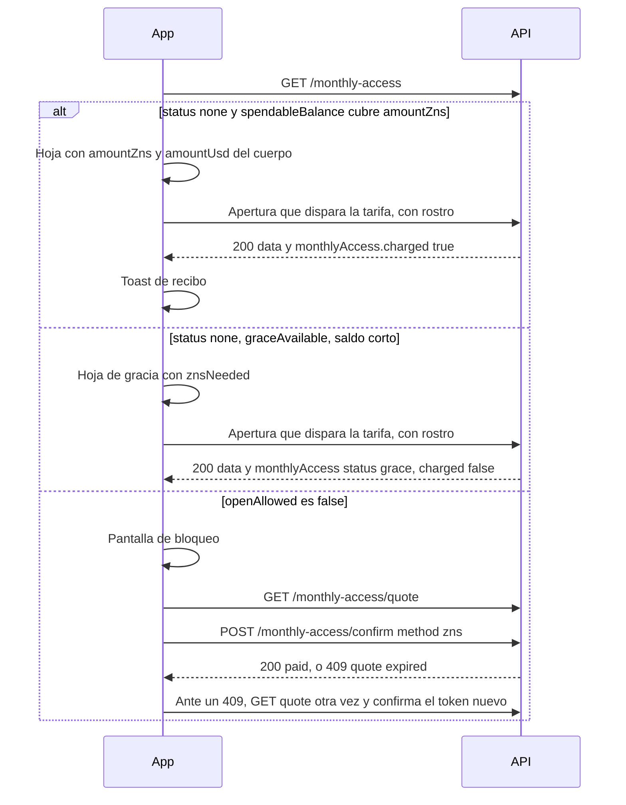

# Acceso mensual

Consulta el mes UTC de un Zelf ID Free, cotiza la tarifa en ZNS y confírmala. Una apertura de la bóveda que dispara la tarifa la cobra una vez, o registra una apertura de gracia cuando el saldo no alcanza.

:::info Implementada, todavía no en producción

Implementada en [zelf-online-version#211](https://github.com/ZelfOfficial/zelf-online-version/pull/211). Todavía no está en producción. Lo descrito en esta página corre solo mientras un interruptor del servidor está encendido. Con el interruptor apagado, `GET /api/zelf-ids/monthly-access` devuelve `enabled: false` y las aperturas de la bóveda siguen como hoy.

Las reglas de producto están en la [propuesta](/docs-es/api/zelf-ids/propuesta-acceso-mensual-zns). Los dólares salen de la licencia, igual que en [Payment Options](/docs/api/zelf-ids/payment-options). Los ejemplos de abajo usan **49 ZNS** para un Premium de **$29** al año a **$0.05** por ZNS. Esas cifras son ejemplos. La extensión debe mostrar `amountZns` y `amountUsd` de la cotización.

:::

## Autenticación

Estas tres rutas están en el router protegido de Zelf ID. Envía el JWT de sesión de `POST /api/sessions`:

```
Authorization: Bearer YOUR_JWT_TOKEN
```

Sin token la respuesta es `401`:

```json
{ "error": "Protected resource, use Authorization header to get access" }
```

El `GET` de estado y el `GET` de cotización exigen además que el nombre de la sesión sea el Zelf ID de la query. `tagName` más `domain` se normaliza y se compara con el `tagName` de la sesión. Una sesión sin Zelf ID es `401` `ERR_ZELF_IDENTITY_REQUIRED`. Otro nombre es `403` `ERR_SESSION_OWNER_MISMATCH`.

La **ventana de 10 minutos verificada con el rostro no hace falta** para el estado, la cotización ni la confirmación. La extensión puede leer el mes y mostrar una hoja antes de encender la cámara.

`POST` confirm no recibe `tagName`. El nombre es el de la sesión, y debe coincidir con `zelfName` dentro de la cotización firmada. Confirm tampoco exige la ventana de 10 minutos.

[My plan](#my-plan) sí exige esa ventana de 10 minutos. Usa `GET /api/zelf-ids/monthly-access` antes de la cámara. Usa `my-plan` cuando la sesión ya está verificada.

Abrir la bóveda sigue usando la prueba de rostro que esas rutas ya piden. Ver [Aperturas que disparan la tarifa](#aperturas-que-disparan-la-tarifa).

## Estado

```
GET https://v4.zelf.world/api/zelf-ids/monthly-access
```

### Parámetros

| Parámetro | Tipo | Obligatorio | Descripción |
|-----------|------|-------------|-------------|
| `tagName` | string | Sí | Nombre sin dominio. Debe ser el nombre de la sesión. |
| `domain` | string | No | TLD. Por defecto `zelf`. |

### Respuesta

`200` con `{ "data": { ... } }`.

| Campo | Tipo | Descripción |
|-------|------|-------------|
| `enabled` | boolean | `false` mientras el interruptor del servidor está apagado. |
| `zelfName` | string | Nombre normalizado, por ejemplo `myname.zelf`. |
| `plan` | string | `free`, `premium` o `unlimited`. Se omite cuando `enabled` es false. |
| `periodKey` | string | Mes UTC, `YYYY-MM`. |
| `status` | string | `none`, `grace`, `paid`, `exempt`, `pending` o `disabled`. |
| `reason` | string | En `exempt`, `premium` o `unlimited`. |
| `openAllowed` | boolean | `false` cuando otra apertura que dispara la tarifa quedaría bloqueada. |
| `graceAvailable` | boolean | `true` solo cuando `status` es `none` y este mes todavía puede usar la apertura de gracia. |
| `spendableBalance` | number o null | ZNS en cadena menos los ZNS ya comprometidos. `null` cuando el saldo no se puede leer. |
| `onChainBalance` | number o null | ZNS en cadena. |
| `tokensSpent` | number | ZNS ya comprometidos, incluida una tarifa mensual pagada. |
| `amountZns` | number | ZNS enteros de este mes. |
| `amountUsd` | string | Precio de un año de Premium dividido entre 12. |
| `tokenPriceUsd` | number | Precio de ZNS del servidor usado en esta respuesta. |
| `floorUsd` | number | Piso mensual usado en esta respuesta. |
| `premiumYearlyUsd` | number | Celda de un año de Premium en la licencia. |
| `znsNeeded` | number | `amountZns` menos el saldo disponible, nunca por debajo de 0. `0` cuando no hay nada que pagar. |
| `options` | array | Presente en `none`, `grace` y `pending`. |
| `record` | object o null | Mes guardado. `null` cuando `status` es `none`. |
| `history` | array | Hasta 12 meses `grace` o `paid`, el `periodKey` más nuevo primero. |

Elementos de `options`, en este orden:

| `type` | Campos |
|--------|--------|
| `upgrade` | `plan` es `premium`. |
| `card` | `available` es `false` hoy. `amountUsd` son los dólares del mes. |
| `zns` | `amountZns` y `znsNeeded`. |

`record` y cada fila de `history`:

| Campo | Tipo | Descripción |
|-------|------|-------------|
| `zelfName` | string | Nombre. |
| `periodKey` | string | `YYYY-MM`. |
| `status` | string | `grace` o `paid`. Una fila que todavía se está escribiendo vuelve como `pending`. |
| `amountZns` | number | ZNS de esa fila. |
| `amountUsd` | string | Dólares de esa fila. |
| `tokenPriceUsd` | number | Precio del token fijado en esa fila. |
| `premiumYearlyUsd` | number | Celda anual de Premium fijada en esa fila. |
| `floorUsd` | number | Piso fijado en esa fila. |
| `trigger` | string | Qué escribió la fila, por ejemplo `retrieve` o `confirm`. |
| `quoteId` | string | Id de la cotización guardada con la fila. |
| `settlement` | string o null | `zns` después de un pago en ZNS. `null` en una fila de gracia. |
| `graceAt` | string o null | Hora ISO-8601 de la apertura de gracia. |
| `chargedAt` | string o null | Hora ISO-8601 del pago. |

`openAllowed` es `false` cuando `status` es `grace` o `pending`, y cuando `status` es `none`, el saldo no alcanza y `graceAvailable` es `false` porque la gracia del mes anterior nunca se pagó.

import Tabs from '@theme/Tabs';
import TabItem from '@theme/TabItem';

<Tabs>
<TabItem value="none" label="none" default>

Todavía no hay una apertura que dispare la tarifa este mes. En este ejemplo el saldo es 0, así que `znsNeeded` es igual a `amountZns`. `graceAvailable` es `true` porque el mes anterior se pagó o no tuvo un uso que dispare la tarifa.

```json
{
  "data": {
    "enabled": true,
    "zelfName": "myname.zelf",
    "plan": "free",
    "periodKey": "2026-10",
    "status": "none",
    "openAllowed": true,
    "graceAvailable": true,
    "spendableBalance": 0,
    "onChainBalance": 0,
    "tokensSpent": 0,
    "amountZns": 49,
    "amountUsd": "2.4166666667",
    "tokenPriceUsd": 0.05,
    "floorUsd": 0.1,
    "premiumYearlyUsd": 29,
    "znsNeeded": 49,
    "options": [
      { "type": "upgrade", "plan": "premium" },
      { "type": "card", "available": false, "amountUsd": "2.4166666667" },
      { "type": "zns", "amountZns": 49, "znsNeeded": 49 }
    ],
    "record": null,
    "history": []
  }
}
```

</TabItem>
<TabItem value="grace" label="grace">

La apertura de gracia ya ocurrió. Las aperturas posteriores que disparan la tarifa quedan bloqueadas hasta que el mes se pague. Este ejemplo todavía tiene 3 ZNS, así que `znsNeeded` es 46.

```json
{
  "data": {
    "enabled": true,
    "zelfName": "myname.zelf",
    "plan": "free",
    "periodKey": "2026-10",
    "status": "grace",
    "openAllowed": false,
    "graceAvailable": false,
    "spendableBalance": 3,
    "onChainBalance": 3,
    "tokensSpent": 0,
    "amountZns": 49,
    "amountUsd": "2.4166666667",
    "tokenPriceUsd": 0.05,
    "floorUsd": 0.1,
    "premiumYearlyUsd": 29,
    "znsNeeded": 46,
    "options": [
      { "type": "upgrade", "plan": "premium" },
      { "type": "card", "available": false, "amountUsd": "2.4166666667" },
      { "type": "zns", "amountZns": 49, "znsNeeded": 46 }
    ],
    "record": {
      "zelfName": "myname.zelf",
      "periodKey": "2026-10",
      "status": "grace",
      "amountZns": 49,
      "amountUsd": "2.4166666667",
      "tokenPriceUsd": 0.05,
      "premiumYearlyUsd": 29,
      "floorUsd": 0.1,
      "trigger": "retrieve",
      "quoteId": "example-quote-id",
      "settlement": null,
      "graceAt": "2026-10-25T16:00:00.000Z",
      "chargedAt": null
    },
    "history": []
  }
}
```

</TabItem>
<TabItem value="paid" label="paid">

El mes está pagado. Las aperturas posteriores que disparan la tarifa siguen. `options` no viene.

```json
{
  "data": {
    "enabled": true,
    "zelfName": "myname.zelf",
    "plan": "free",
    "periodKey": "2026-10",
    "status": "paid",
    "openAllowed": true,
    "graceAvailable": false,
    "spendableBalance": 51,
    "onChainBalance": 100,
    "tokensSpent": 49,
    "amountZns": 49,
    "amountUsd": "2.4166666667",
    "tokenPriceUsd": 0.05,
    "floorUsd": 0.1,
    "premiumYearlyUsd": 29,
    "znsNeeded": 0,
    "record": {
      "zelfName": "myname.zelf",
      "periodKey": "2026-10",
      "status": "paid",
      "amountZns": 49,
      "amountUsd": "2.4166666667",
      "tokenPriceUsd": 0.05,
      "premiumYearlyUsd": 29,
      "floorUsd": 0.1,
      "trigger": "confirm",
      "quoteId": "example-quote-id",
      "settlement": "zns",
      "graceAt": "2026-10-25T16:00:00.000Z",
      "chargedAt": "2026-10-25T18:00:00.000Z"
    },
    "history": []
  }
}
```

</TabItem>
<TabItem value="exempt" label="exempt">

Premium o Unlimited, mientras ese plazo está activo. Este cuerpo no trae un monto en ZNS.

```json
{
  "data": {
    "enabled": true,
    "zelfName": "myname.zelf",
    "plan": "premium",
    "periodKey": "2026-10",
    "status": "exempt",
    "reason": "premium",
    "openAllowed": true,
    "graceAvailable": false,
    "history": []
  }
}
```

</TabItem>
<TabItem value="disabled" label="interruptor apagado">

El interruptor del servidor está apagado. Las aperturas de la bóveda no cambian, y `my-plan` omite `monthlyAccess`.

```json
{
  "data": {
    "enabled": false,
    "status": "disabled",
    "openAllowed": true,
    "periodKey": "2026-10",
    "zelfName": "myname.zelf"
  }
}
```

</TabItem>
</Tabs>

`status` `pending` significa que una escritura está en curso. `openAllowed` es `false`. Hay que volver a consultar el estado.

## Cotización

```
GET https://v4.zelf.world/api/zelf-ids/monthly-access/quote
```

La misma query y la misma comprobación de sesión que el [estado](#estado). No se debitan ZNS y no se escribe una fila del mes.

`ttl` es un tiempo Unix en segundos, **2 horas** desde la cotización, en UTC. `signedDataPrice` es el JWT que se envía como `token` en la confirmación. `typ` es `monthly_access`. `floorZns` es el piso convertido con el mismo redondeo a ZNS enteros que `amountZns`.

```json
{
  "data": {
    "typ": "monthly_access",
    "zelfName": "myname.zelf",
    "periodKey": "2026-10",
    "premiumYearlyUsd": 29,
    "amountUsd": "2.4166666667",
    "tokenPriceUsd": 0.05,
    "floorUsd": 0.1,
    "floorZns": 2,
    "amountZns": 49,
    "quoteId": "example-quote-id",
    "ttl": 1761415200,
    "signedDataPrice": "[JWT]",
    "spendableBalance": 0,
    "znsNeeded": 49,
    "options": [
      { "type": "upgrade", "plan": "premium" },
      { "type": "card", "available": false, "amountUsd": "2.4166666667" },
      { "type": "zns", "amountZns": 49, "znsNeeded": 49 }
    ]
  }
}
```

El `ttl` de ese ejemplo es solo un marcador. Usa el número de la respuesta.

Un nombre exento devuelve `status` `exempt`, `reason` `premium` o `unlimited`, `openAllowed` `true` y `signedDataPrice` `null`.

Con el interruptor apagado, la cotización devuelve `409` `monthly_access_disabled`.

## Confirmar

```
POST https://v4.zelf.world/api/zelf-ids/monthly-access/confirm
```

### Cuerpo

| Campo | Tipo | Obligatorio | Descripción |
|-------|------|-------------|-------------|
| `token` | string | Sí | `signedDataPrice` de la cotización. |
| `method` | string | No | `zns` o `card`. Por defecto `zns`. |

`method` `zns` debita `amountZns` de la cotización firmada cuando el saldo disponible lo cubre. El mes pasa a `paid` con `settlement` `zns`. Un mes que estaba en `grace` pasa a `paid`.

Enviar la misma cotización otra vez cuando el mes ya está `paid` devuelve la fila pagada con `charged` `false` e `idempotent` `true`. No vuelve a debitar.

`method` `card` devuelve `409` `monthly_access_card_unavailable`. El mes no cambia.

Una cotización cuyo `ttl` ya pasó, o cuyo `periodKey` no es el mes UTC actual, devuelve `409` `monthly_access_quote_expired`. Hay que pedir una cotización nueva y confirmar esa.

```json
{
  "data": {
    "zelfName": "myname.zelf",
    "periodKey": "2026-10",
    "status": "paid",
    "amountZns": 49,
    "amountUsd": "2.4166666667",
    "tokenPriceUsd": 0.05,
    "premiumYearlyUsd": 29,
    "floorUsd": 0.1,
    "trigger": "confirm",
    "quoteId": "example-quote-id",
    "settlement": "zns",
    "graceAt": null,
    "chargedAt": "2026-10-25T18:00:00.000Z",
    "charged": true,
    "idempotent": false,
    "spendableBalance": 51
  }
}
```

Un nombre exento devuelve `status` `exempt`, `charged` `false` e `idempotent` `true`, sin débito.

## My plan

`GET https://v4.zelf.world/api/zelf-ids/my-plan?zelfName=myname.zelf` agrega `monthlyAccess` mientras el interruptor del servidor está encendido. El objeto coincide con el [estado](#estado), incluido `history`.

Con el interruptor apagado, `monthlyAccess` no viene.

Si la consulta de estado falla, `my-plan` igual devuelve el plan y deja:

```json
{
  "monthlyAccess": {
    "enabled": true,
    "zelfName": "myname.zelf",
    "plan": "free",
    "status": "unavailable",
    "openAllowed": true
  }
}
```

`my-plan` exige la ventana verificada de 10 minutos. El estado y la cotización no.

El botón de subir a Premium usa `upgrade.url` de `my-plan`. El precio de Premium de ese camino sale de [Payment Options](/docs/api/zelf-ids/payment-options).

## Aperturas que disparan la tarifa

Estas llamadas cobran el mes, o registran la apertura de gracia, después de que la apertura tiene éxito. Si el mes ya está bloqueado, devuelven `402` y no devuelven el contenido de la bóveda.

| Método y ruta | `monthlyAccess` después de un cobro |
|---------------|--------------------------------------|
| `POST https://v4.zelf.world/api/zelf-keys/retrieve` | `trigger` `retrieve` |
| `POST https://v4.zelf.world/api/zelf-ids/decrypt` | `trigger` `decrypt` |
| `POST https://v4.zelf.world/api/tags/decrypt` | `trigger` `tags-decrypt` |
| `POST https://v4.zelf.world/api/zelf-name-service/v2/decrypt` | `trigger` `zns-decrypt` |
| `POST https://v4.zelf.world/api/my-wallets/decrypt` | `trigger` `wallet-decrypt` |

Cada una sigue exigiendo la prueba de rostro que exige hoy.

En el primer cobro el cuerpo es el `{ "data": ... }` de siempre más:

```json
{
  "monthlyAccess": {
    "zelfName": "myname.zelf",
    "periodKey": "2026-10",
    "status": "paid",
    "amountZns": 49,
    "amountUsd": "2.4166666667",
    "tokenPriceUsd": 0.05,
    "premiumYearlyUsd": 29,
    "floorUsd": 0.1,
    "trigger": "retrieve",
    "quoteId": "example-quote-id",
    "settlement": "zns",
    "graceAt": null,
    "chargedAt": "2026-10-25T16:05:00.000Z",
    "charged": true,
    "idempotent": false,
    "spendableBalance": 51
  }
}
```

Muestra el toast de recibo cuando `monthlyAccess.charged` es `true`.

Una apertura de gracia devuelve la bóveda y:

```json
{
  "monthlyAccess": {
    "zelfName": "myname.zelf",
    "periodKey": "2026-10",
    "status": "grace",
    "amountZns": 49,
    "amountUsd": "2.4166666667",
    "tokenPriceUsd": 0.05,
    "premiumYearlyUsd": 29,
    "floorUsd": 0.1,
    "trigger": "retrieve",
    "quoteId": "example-quote-id",
    "settlement": null,
    "graceAt": "2026-10-25T16:00:00.000Z",
    "chargedAt": null,
    "charged": false,
    "spendableBalance": 0,
    "znsNeeded": 49
  }
}
```

Una apertura posterior en un mes pagado devuelve `monthlyAccess.charged` `false` e `idempotent` `true`.

Un plazo Premium o Unlimited activo devuelve `monthlyAccess.status` `exempt` y ese objeto no trae `charged`. `openAllowed` es `true`.

Con el interruptor apagado, estas respuestas siguen siendo `{ "data": ... }` sin `monthlyAccess`.

## Llamadas exentas

Estas no crean una fila del mes, no consumen la apertura de gracia y no agregan `monthlyAccess`.

| Llamada | Nota |
|---------|------|
| `POST /api/rewards/daily` | Recompensa diaria. Rostro, y la contraseña maestra cuando el Zelf ID la tiene. |
| Guardar y agregar en Zelf Keys | Contraseña, 2FA, nota, tarjeta. |
| Borrar, vista previa y cambio de contraseña maestra en Zelf Keys | |
| `POST /api/zelf-keys/slots` | Espacio extra. Tiene su propio precio en ZNS. |
| `POST /api/zelf-ids/payment-confirmation` | Pago del plan del nombre. |
| `POST /api/zelf-ids/lease` y recuperación del lease | `POST /api/zelf-ids/lease-recovery` |
| `POST /api/my-wallets` crear y `POST /api/my-wallets/import` | |
| `POST /api/my-wallets/export` | Prueba de rostro, igual que el descifrado de la billetera. No registra el mes. Sirve para mover los fondos del dueño mientras un mes está bloqueado. |
| Transferencia del nombre y extensión de licencia | |

## Errores

| HTTP | `code` | Cuándo |
|------|--------|--------|
| 401 | | No hay JWT de sesión. El cuerpo es `{ "error": "Protected resource, use Authorization header to get access" }`. |
| 401 | `ERR_ZELF_IDENTITY_REQUIRED` | La sesión no tiene Zelf ID. |
| 401 | `monthly_access_quote_invalid` | `token` no es una cotización de acceso mensual. Mensaje: `Monthly access quote is not valid`. |
| 403 | `ERR_SESSION_OWNER_MISMATCH` | El nombre de la sesión no es el de la query, o no es el nombre dentro de la cotización. |
| 402 | `monthly_access_payment_required` | Esta apertura que dispara la tarifa está bloqueada, o la confirmación no tiene ZNS suficientes. |
| 409 | | Validación Joi. El cuerpo es `{ "validationError": "..." }`, por ejemplo cuando falta `tagName` o `token`. |
| 409 | `monthly_access_disabled` | Cotización o confirmación con el interruptor apagado. Mensaje: `Monthly access is not enabled`. |
| 409 | `monthly_access_quote_expired` | `ttl` ya pasó, o `periodKey` no es el mes UTC actual. Mensaje: `Monthly access quote has expired. Request a new quote.` |
| 409 | `monthly_access_card_unavailable` | `method` es `card`. |
| 409 | `monthly_access_price_unavailable` | La licencia no tiene un precio de un año de Premium para convertir. |
| 409 | `monthly_access_in_progress` | Una escritura de este mes todavía no termina. Reintentar. |
| 503 | `ERR_TOKEN_BALANCE_UNAVAILABLE` | La confirmación no puede leer el saldo de ZNS. |

Cuerpo `402` de una apertura bloqueada o de una confirmación con saldo corto:

```json
{
  "message": "Monthly access payment is required",
  "code": "monthly_access_payment_required",
  "periodKey": "2026-10",
  "amountZns": 49,
  "amountUsd": "2.4166666667",
  "tokenPriceUsd": 0.05,
  "floorUsd": 0.1,
  "premiumYearlyUsd": 29,
  "spendableBalance": 0,
  "znsNeeded": 49,
  "openAllowed": false,
  "options": [
    { "type": "upgrade", "plan": "premium" },
    { "type": "card", "available": false, "amountUsd": "2.4166666667" },
    { "type": "zns", "amountZns": 49, "znsNeeded": 49 }
  ]
}
```

`409` de tarjeta:

```json
{
  "message": "Card payment for this month is not available yet",
  "code": "monthly_access_card_unavailable",
  "periodKey": "2026-10",
  "amountUsd": "2.4166666667",
  "amountZns": 49,
  "quoteId": "example-quote-id"
}
```

## Guía para la extensión

Lee `GET /api/zelf-ids/monthly-access` antes de la cámara. Muestra el mes y `spendableBalance` de ese cuerpo, o de `my-plan.monthlyAccess` cuando la sesión ya está verificada. No dejes escritos 49, `$2.42` ni `$0.05`.



1. **Primera apertura, el saldo cubre la tarifa.** `status` es `none` y `spendableBalance` es al menos `amountZns`. La hoja muestra esos dos campos y `amountUsd`. La apertura que dispara la tarifa devuelve entonces `monthlyAccess.charged` `true`. Muestra un toast de recibo con `amountZns`, `amountUsd` y `periodKey`. La extensión también puede hacer `POST` confirm antes de la cámara. Después, la apertura es idempotente y `charged` es `false`.
2. **Apertura de gracia.** `status` es `none`, `graceAvailable` es `true` y `znsNeeded` es mayor que 0. La hoja dice que este es el pase libre del mes y muestra `znsNeeded` y `amountZns`. La apertura funciona. `monthlyAccess.status` es `grace` y `charged` es `false`.
3. **Bloqueo.** `openAllowed` es `false`, o la llamada devuelve `402`. No enciendas la cámara. La pantalla de bloqueo ofrece **Subir a Premium** (`upgrade.url` de `my-plan`) y **Conseguir más ZNS** (`POST /api/rewards/daily` cuando el reclamo de hoy sigue abierto). Oculta el botón de tarjeta mientras `options` tenga `card.available` `false`. Cuando la persona tenga ZNS suficientes, cotiza y luego confirma con `method` `zns`. Un `409` `monthly_access_quote_expired` significa que la cotización de dos horas venció o que cambió el mes UTC: vuelve a cotizar y confirma el `signedDataPrice` nuevo. Después la apertura de la bóveda sigue.
4. **Ya pagado o exento.** Sáltate la hoja. `openAllowed` es `true`.

## Ejemplos

<Tabs>
<TabItem value="curl" label="cURL" default>

```bash
curl -X GET "https://v4.zelf.world/api/zelf-ids/monthly-access?tagName=myname&domain=zelf" \
  -H "Authorization: Bearer YOUR_JWT_TOKEN" \
  -H "Origin: https://yourdomain.com"
```

</TabItem>
<TabItem value="nodejs" label="Node.js">

```javascript
const axios = require('axios');

const status = await axios.get('https://v4.zelf.world/api/zelf-ids/monthly-access', {
  params: { tagName: 'myname', domain: 'zelf' },
  headers: { Authorization: `Bearer ${token}`, Origin: 'https://yourdomain.com' },
});

console.log(status.data.data.status, status.data.data.amountZns);
```

</TabItem>
<TabItem value="python" label="Python">

```python
import requests

response = requests.get(
    "https://v4.zelf.world/api/zelf-ids/monthly-access",
    params={"tagName": "myname", "domain": "zelf"},
    headers={"Authorization": f"Bearer {token}", "Origin": "https://yourdomain.com"},
)
print(response.json()["data"]["status"])
```

</TabItem>
<TabItem value="php" label="PHP">

```php
<?php
$ch = curl_init('https://v4.zelf.world/api/zelf-ids/monthly-access?tagName=myname&domain=zelf');
curl_setopt_array($ch, [
    CURLOPT_RETURNTRANSFER => true,
    CURLOPT_HTTPHEADER => [
        'Authorization: Bearer YOUR_JWT_TOKEN',
        'Origin: https://yourdomain.com',
    ],
]);
$body = json_decode(curl_exec($ch), true);
echo $body['data']['status'];
```

</TabItem>
<TabItem value="rust" label="Rust">

```rust
use reqwest;
use serde_json::Value;

#[tokio::main]
async fn main() -> Result<(), Box<dyn std::error::Error>> {
    let token = "YOUR_JWT_TOKEN";
    let client = reqwest::Client::new();
    let response = client
        .get("https://v4.zelf.world/api/zelf-ids/monthly-access")
        .query(&[("tagName", "myname"), ("domain", "zelf")])
        .header("Origin", "https://yourdomain.com")
        .header("Authorization", format!("Bearer {}", token))
        .send()
        .await?;
    let body: Value = response.json().await?;
    println!("{}", body["data"]["status"]);
    Ok(())
}
```

</TabItem>
</Tabs>

La confirmación usa los mismos encabezados. `token` es el `signedDataPrice` de la cotización. El `49` de los ejemplos es una ilustración de lo que puede traer una cotización. Envía el token que recibiste, no un monto guardado.

<Tabs>
<TabItem value="curl" label="cURL" default>

```bash
curl -X POST "https://v4.zelf.world/api/zelf-ids/monthly-access/confirm" \
  -H "Authorization: Bearer YOUR_JWT_TOKEN" \
  -H "Origin: https://yourdomain.com" \
  -H "Content-Type: application/json" \
  -d '{"token":"SIGNED_QUOTE_JWT","method":"zns"}'
```

</TabItem>
<TabItem value="nodejs" label="Node.js">

```javascript
const axios = require('axios');

const confirmed = await axios.post(
  'https://v4.zelf.world/api/zelf-ids/monthly-access/confirm',
  { token: signedDataPrice, method: 'zns' },
  { headers: { Authorization: `Bearer ${token}`, Origin: 'https://yourdomain.com' } },
);

console.log(confirmed.data.data.charged, confirmed.data.data.idempotent);
```

</TabItem>
<TabItem value="python" label="Python">

```python
confirmed = requests.post(
    "https://v4.zelf.world/api/zelf-ids/monthly-access/confirm",
    json={"token": signed_data_price, "method": "zns"},
    headers={"Authorization": f"Bearer {token}", "Origin": "https://yourdomain.com"},
)
print(confirmed.json()["data"]["status"])
```

</TabItem>
<TabItem value="php" label="PHP">

```php
<?php
$payload = json_encode(['token' => $signedDataPrice, 'method' => 'zns']);
$ch = curl_init('https://v4.zelf.world/api/zelf-ids/monthly-access/confirm');
curl_setopt_array($ch, [
    CURLOPT_POST => true,
    CURLOPT_POSTFIELDS => $payload,
    CURLOPT_RETURNTRANSFER => true,
    CURLOPT_HTTPHEADER => [
        'Authorization: Bearer YOUR_JWT_TOKEN',
        'Origin: https://yourdomain.com',
        'Content-Type: application/json',
    ],
]);
$body = json_decode(curl_exec($ch), true);
echo $body['data']['status'];
```

</TabItem>
<TabItem value="rust" label="Rust">

```rust
use reqwest;
use serde_json::Value;

#[tokio::main]
async fn main() -> Result<(), Box<dyn std::error::Error>> {
    let token = "YOUR_JWT_TOKEN";
    let signed_data_price = "SIGNED_QUOTE_JWT";
    let client = reqwest::Client::new();
    let response = client
        .post("https://v4.zelf.world/api/zelf-ids/monthly-access/confirm")
        .header("Origin", "https://yourdomain.com")
        .header("Authorization", format!("Bearer {}", token))
        .json(&serde_json::json!({ "token": signed_data_price, "method": "zns" }))
        .send()
        .await?;
    let body: Value = response.json().await?;
    println!("{}", body["data"]["status"]);
    Ok(())
}
```

</TabItem>
</Tabs>

## Relacionado

- [Propuesta: acceso mensual ZNS para cuentas Free](/docs-es/api/zelf-ids/propuesta-acceso-mensual-zns)
- [Planes](/docs-es/api/zelf-ids/planes)
- [Payment Options](/docs/api/zelf-ids/payment-options)
