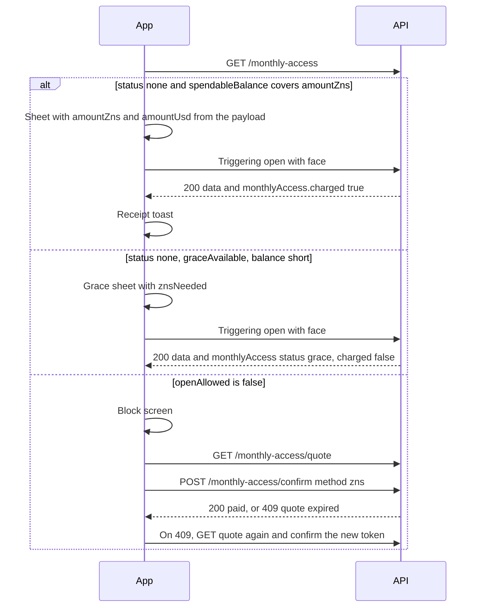

# Monthly Access

Read the current UTC month for a Free Zelf ID, quote the ZNS fee, and confirm it. A triggering open of the vault charges that fee once, or records one grace open when the balance is short.

:::info Implemented, not live

Implemented in [zelf-online-version#211](https://github.com/ZelfOfficial/zelf-online-version/pull/211). Not live yet. The behavior on this page runs only while a server switch is on. While the switch is off, `GET /api/zelf-ids/monthly-access` returns `enabled: false` and the vault opens as they do today.

The product rules are in the [proposal](/docs/api/zelf-ids/monthly-zns-access-proposal). Dollar amounts come from the license, the same way as [Payment Options](/docs/api/zelf-ids/payment-options). The examples below use **49 ZNS** for a **$29** one-year Premium price at **$0.05** per ZNS. Those numbers are examples. The extension must show `amountZns` and `amountUsd` from the quote.

:::

## Authentication

These three routes sit on the protected Zelf ID router. Send the session JWT from `POST /api/sessions`:

```
Authorization: Bearer YOUR_JWT_TOKEN
```

A missing token is `401`:

```json
{ "error": "Protected resource, use Authorization header to get access" }
```

`GET` status and `GET` quote also require the session name to be the Zelf ID in the query. `tagName` plus `domain` is normalized and compared with the session `tagName`. A session with no Zelf ID is `401` `ERR_ZELF_IDENTITY_REQUIRED`. A different name is `403` `ERR_SESSION_OWNER_MISMATCH`.

The **10-minute verified face window is not required** for status, quote, or confirm. The extension can read the month and show a sheet before the camera starts.

`POST` confirm does not take `tagName`. The name is the session name, and it must match `zelfName` inside the signed quote. Confirm also does not require the 10-minute window.

[My plan](#my-plan) still requires that 10-minute window. Use `GET /api/zelf-ids/monthly-access` before the camera. Use `my-plan` when the session is already verified.

Opening the vault still uses the face check those routes already require. See [Triggering opens](#triggering-opens).

## Status

```
GET https://v4.zelf.world/api/zelf-ids/monthly-access
```

### Parameters

| Parameter | Type | Required | Description |
|-----------|------|----------|-------------|
| `tagName` | string | Yes | Bare name. Must be the session name. |
| `domain` | string | No | TLD. Default `zelf`. |

### Response

`200` with `{ "data": { ... } }`.

| Field | Type | Description |
|-------|------|-------------|
| `enabled` | boolean | `false` while the server switch is off. |
| `zelfName` | string | Normalized name, such as `myname.zelf`. |
| `plan` | string | `free`, `premium`, or `unlimited`. Omitted when `enabled` is false. |
| `periodKey` | string | UTC month, `YYYY-MM`. |
| `status` | string | `none`, `grace`, `paid`, `exempt`, `pending`, or `disabled`. |
| `reason` | string | On `exempt`, `premium` or `unlimited`. |
| `openAllowed` | boolean | `false` when another triggering open would be blocked. |
| `graceAvailable` | boolean | `true` only when `status` is `none` and this month may still use the one grace open. |
| `spendableBalance` | number or null | On-chain ZNS minus ZNS already committed. `null` when the balance cannot be read. |
| `onChainBalance` | number or null | On-chain ZNS. |
| `tokensSpent` | number | ZNS already committed, including a paid monthly fee. |
| `amountZns` | number | Whole ZNS for this month. |
| `amountUsd` | string | One-year Premium price divided by 12. |
| `tokenPriceUsd` | number | Server ZNS price used for this response. |
| `floorUsd` | number | Monthly floor used for this response. |
| `premiumYearlyUsd` | number | One-year Premium cell from the license. |
| `znsNeeded` | number | `amountZns` minus the spendable balance, and never below 0. `0` when nothing is due. |
| `options` | array | Present for `none`, `grace`, and `pending`. |
| `record` | object or null | Stored month. `null` when `status` is `none`. |
| `history` | array | Up to 12 `grace` or `paid` months, newest `periodKey` first. |

`options` items, in this order:

| `type` | Fields |
|--------|--------|
| `upgrade` | `plan` is `premium`. |
| `card` | `available` is `false` today. `amountUsd` is the month's USD. |
| `zns` | `amountZns` and `znsNeeded`. |

`record` and each `history` row:

| Field | Type | Description |
|-------|------|-------------|
| `zelfName` | string | Name. |
| `periodKey` | string | `YYYY-MM`. |
| `status` | string | `grace` or `paid`. A row still being written is returned as `pending`. |
| `amountZns` | number | ZNS on that row. |
| `amountUsd` | string | USD on that row. |
| `tokenPriceUsd` | number | Token price locked on that row. |
| `premiumYearlyUsd` | number | Yearly Premium cell locked on that row. |
| `floorUsd` | number | Floor locked on that row. |
| `trigger` | string | What wrote the row, such as `retrieve` or `confirm`. |
| `quoteId` | string | Id of the quote stored with the row. |
| `settlement` | string or null | `zns` after a ZNS payment. `null` on a grace row. |
| `graceAt` | string or null | ISO-8601 time of the grace open. |
| `chargedAt` | string or null | ISO-8601 time of the payment. |

`openAllowed` is `false` when `status` is `grace` or `pending`, and when `status` is `none`, the balance is short, and `graceAvailable` is `false` because the previous month's grace was never paid.

import Tabs from '@theme/Tabs';
import TabItem from '@theme/TabItem';

<Tabs>
<TabItem value="none" label="none" default>

No triggering open yet this month. The balance in this example is 0, so `znsNeeded` equals `amountZns`. `graceAvailable` is `true` because the previous month was paid or had no triggering use.

```json
{
  "data": {
    "enabled": true,
    "zelfName": "myname.zelf",
    "plan": "free",
    "periodKey": "2026-10",
    "status": "none",
    "openAllowed": true,
    "graceAvailable": true,
    "spendableBalance": 0,
    "onChainBalance": 0,
    "tokensSpent": 0,
    "amountZns": 49,
    "amountUsd": "2.4166666667",
    "tokenPriceUsd": 0.05,
    "floorUsd": 0.1,
    "premiumYearlyUsd": 29,
    "znsNeeded": 49,
    "options": [
      { "type": "upgrade", "plan": "premium" },
      { "type": "card", "available": false, "amountUsd": "2.4166666667" },
      { "type": "zns", "amountZns": 49, "znsNeeded": 49 }
    ],
    "record": null,
    "history": []
  }
}
```

</TabItem>
<TabItem value="grace" label="grace">

The grace open already happened. Further triggering opens are blocked until the month is paid. This example still has 3 ZNS, so `znsNeeded` is 46.

```json
{
  "data": {
    "enabled": true,
    "zelfName": "myname.zelf",
    "plan": "free",
    "periodKey": "2026-10",
    "status": "grace",
    "openAllowed": false,
    "graceAvailable": false,
    "spendableBalance": 3,
    "onChainBalance": 3,
    "tokensSpent": 0,
    "amountZns": 49,
    "amountUsd": "2.4166666667",
    "tokenPriceUsd": 0.05,
    "floorUsd": 0.1,
    "premiumYearlyUsd": 29,
    "znsNeeded": 46,
    "options": [
      { "type": "upgrade", "plan": "premium" },
      { "type": "card", "available": false, "amountUsd": "2.4166666667" },
      { "type": "zns", "amountZns": 49, "znsNeeded": 46 }
    ],
    "record": {
      "zelfName": "myname.zelf",
      "periodKey": "2026-10",
      "status": "grace",
      "amountZns": 49,
      "amountUsd": "2.4166666667",
      "tokenPriceUsd": 0.05,
      "premiumYearlyUsd": 29,
      "floorUsd": 0.1,
      "trigger": "retrieve",
      "quoteId": "example-quote-id",
      "settlement": null,
      "graceAt": "2026-10-25T16:00:00.000Z",
      "chargedAt": null
    },
    "history": []
  }
}
```

</TabItem>
<TabItem value="paid" label="paid">

The month is paid. Later triggering opens proceed. `options` is omitted.

```json
{
  "data": {
    "enabled": true,
    "zelfName": "myname.zelf",
    "plan": "free",
    "periodKey": "2026-10",
    "status": "paid",
    "openAllowed": true,
    "graceAvailable": false,
    "spendableBalance": 51,
    "onChainBalance": 100,
    "tokensSpent": 49,
    "amountZns": 49,
    "amountUsd": "2.4166666667",
    "tokenPriceUsd": 0.05,
    "floorUsd": 0.1,
    "premiumYearlyUsd": 29,
    "znsNeeded": 0,
    "record": {
      "zelfName": "myname.zelf",
      "periodKey": "2026-10",
      "status": "paid",
      "amountZns": 49,
      "amountUsd": "2.4166666667",
      "tokenPriceUsd": 0.05,
      "premiumYearlyUsd": 29,
      "floorUsd": 0.1,
      "trigger": "confirm",
      "quoteId": "example-quote-id",
      "settlement": "zns",
      "graceAt": "2026-10-25T16:00:00.000Z",
      "chargedAt": "2026-10-25T18:00:00.000Z"
    },
    "history": []
  }
}
```

</TabItem>
<TabItem value="exempt" label="exempt">

Premium or Unlimited, while that term is active. There is no ZNS amount on this body.

```json
{
  "data": {
    "enabled": true,
    "zelfName": "myname.zelf",
    "plan": "premium",
    "periodKey": "2026-10",
    "status": "exempt",
    "reason": "premium",
    "openAllowed": true,
    "graceAvailable": false,
    "history": []
  }
}
```

</TabItem>
<TabItem value="disabled" label="switch off">

The server switch is off. Vault opens are unchanged, and `my-plan` omits `monthlyAccess`.

```json
{
  "data": {
    "enabled": false,
    "status": "disabled",
    "openAllowed": true,
    "periodKey": "2026-10",
    "zelfName": "myname.zelf"
  }
}
```

</TabItem>
</Tabs>

`status` `pending` means a write is in progress. `openAllowed` is `false`. Retry the status call.

## Quote

```
GET https://v4.zelf.world/api/zelf-ids/monthly-access/quote
```

Same query and the same session check as [status](#status). No ZNS is debited, and no month row is written.

`ttl` is a Unix time in seconds, **2 hours** from the quote, in UTC. `signedDataPrice` is the JWT to send as `token` on confirm. `typ` is `monthly_access`. `floorZns` is the floor converted with the same whole-ZNS rounding as `amountZns`.

```json
{
  "data": {
    "typ": "monthly_access",
    "zelfName": "myname.zelf",
    "periodKey": "2026-10",
    "premiumYearlyUsd": 29,
    "amountUsd": "2.4166666667",
    "tokenPriceUsd": 0.05,
    "floorUsd": 0.1,
    "floorZns": 2,
    "amountZns": 49,
    "quoteId": "example-quote-id",
    "ttl": 1761415200,
    "signedDataPrice": "[JWT]",
    "spendableBalance": 0,
    "znsNeeded": 49,
    "options": [
      { "type": "upgrade", "plan": "premium" },
      { "type": "card", "available": false, "amountUsd": "2.4166666667" },
      { "type": "zns", "amountZns": 49, "znsNeeded": 49 }
    ]
  }
}
```

`ttl` in that example is only a placeholder. Use the number in the response.

An exempt name returns `status` `exempt`, `reason` `premium` or `unlimited`, `openAllowed` `true`, and `signedDataPrice` `null`.

While the switch is off, quote returns `409` `MONTHLY_ACCESS_DISABLED`.

## Confirm

```
POST https://v4.zelf.world/api/zelf-ids/monthly-access/confirm
```

### Body

| Field | Type | Required | Description |
|-------|------|----------|-------------|
| `token` | string | Yes | `signedDataPrice` from the quote. |
| `method` | string | No | `zns` or `card`. Default `zns`. |

`method` `zns` debits `amountZns` from the signed quote when the spendable balance covers it. The month becomes `paid` with `settlement` `zns`. A month that was `grace` converts to `paid`.

Sending the same quote again after the month is `paid` returns the paid row with `charged` `false` and `idempotent` `true`. It does not debit again.

`method` `card` returns `409` `MONTHLY_ACCESS_CARD_UNAVAILABLE`. The month is unchanged.

A quote whose `ttl` is in the past, or whose `periodKey` is not the current UTC month, returns `409` `MONTHLY_ACCESS_QUOTE_EXPIRED`. Request a new quote and confirm that one.

```json
{
  "data": {
    "zelfName": "myname.zelf",
    "periodKey": "2026-10",
    "status": "paid",
    "amountZns": 49,
    "amountUsd": "2.4166666667",
    "tokenPriceUsd": 0.05,
    "premiumYearlyUsd": 29,
    "floorUsd": 0.1,
    "trigger": "confirm",
    "quoteId": "example-quote-id",
    "settlement": "zns",
    "graceAt": null,
    "chargedAt": "2026-10-25T18:00:00.000Z",
    "charged": true,
    "idempotent": false,
    "spendableBalance": 51
  }
}
```

An exempt name returns `status` `exempt`, `charged` `false`, and `idempotent` `true`, with no debit.

## My plan

`GET https://v4.zelf.world/api/zelf-ids/my-plan?zelfName=myname.zelf` adds `monthlyAccess` while the server switch is on. The object matches [status](#status), including `history`.

While the switch is off, `monthlyAccess` is absent.

If the status lookup fails, `my-plan` still returns the plan and sets:

```json
{
  "monthlyAccess": {
    "enabled": true,
    "zelfName": "myname.zelf",
    "plan": "free",
    "status": "unavailable",
    "openAllowed": true
  }
}
```

`my-plan` requires the 10-minute verified window. Status and quote do not.

The Upgrade button uses `upgrade.url` from `my-plan`. The Premium price on that path comes from [Payment Options](/docs/api/zelf-ids/payment-options).

## Triggering opens

These calls charge the month, or record the grace open, after the open succeeds. If the month is already blocked, they return `402` and do not return the vault payload.

| Method and path | `monthlyAccess` after a charge |
|-----------------|--------------------------------|
| `POST https://v4.zelf.world/api/zelf-keys/retrieve` | `trigger` `retrieve` |
| `POST https://v4.zelf.world/api/zelf-ids/decrypt` | `trigger` `decrypt` |
| `POST https://v4.zelf.world/api/tags/decrypt` | `trigger` `tags-decrypt` |
| `POST https://v4.zelf.world/api/zelf-name-service/v2/decrypt` | `trigger` `zns-decrypt` |
| `POST https://v4.zelf.world/api/my-wallets/decrypt` | `trigger` `wallet-decrypt` |

Each of these still requires the face check it requires today.

On a first charge the body is the usual `{ "data": ... }` plus:

```json
{
  "monthlyAccess": {
    "zelfName": "myname.zelf",
    "periodKey": "2026-10",
    "status": "paid",
    "amountZns": 49,
    "amountUsd": "2.4166666667",
    "tokenPriceUsd": 0.05,
    "premiumYearlyUsd": 29,
    "floorUsd": 0.1,
    "trigger": "retrieve",
    "quoteId": "example-quote-id",
    "settlement": "zns",
    "graceAt": null,
    "chargedAt": "2026-10-25T16:05:00.000Z",
    "charged": true,
    "idempotent": false,
    "spendableBalance": 51
  }
}
```

Show the receipt toast when `monthlyAccess.charged` is `true`.

A grace open returns the vault and:

```json
{
  "monthlyAccess": {
    "zelfName": "myname.zelf",
    "periodKey": "2026-10",
    "status": "grace",
    "amountZns": 49,
    "amountUsd": "2.4166666667",
    "tokenPriceUsd": 0.05,
    "premiumYearlyUsd": 29,
    "floorUsd": 0.1,
    "trigger": "retrieve",
    "quoteId": "example-quote-id",
    "settlement": null,
    "graceAt": "2026-10-25T16:00:00.000Z",
    "chargedAt": null,
    "charged": false,
    "spendableBalance": 0,
    "znsNeeded": 49
  }
}
```

A later open in a paid month returns `monthlyAccess.charged` `false` and `idempotent` `true`.

An active Premium or Unlimited term returns `monthlyAccess.status` `exempt` and `charged` is not set on that object. `openAllowed` is `true`.

While the switch is off, these responses stay `{ "data": ... }` with no `monthlyAccess`.

## Exempt calls

These do not create a month row, do not consume the grace open, and do not add `monthlyAccess`.

| Call | Note |
|------|------|
| `POST /api/rewards/daily` | Daily reward. Face, and the master password when the Zelf ID has one. |
| Zelf Keys store and add | Password, 2FA, note, card. |
| Zelf Keys delete, preview, change master password | |
| `POST /api/zelf-keys/slots` | Extra slot. Its own ZNS price. |
| `POST /api/zelf-ids/payment-confirmation` | Name-plan payment. |
| `POST /api/zelf-ids/lease` and lease recovery | `POST /api/zelf-ids/lease-recovery` |
| `POST /api/my-wallets` create and `POST /api/my-wallets/import` | |
| `POST /api/my-wallets/export` | Face check, same as wallet decrypt. Does not record the month. Use this to move the owner's funds while a month is blocked. |
| Name transfer and license extend | |

## Errors

| HTTP | `code` | When |
|------|--------|------|
| 401 | | No session JWT. Body is `{ "error": "Protected resource, use Authorization header to get access" }`. |
| 401 | `ERR_ZELF_IDENTITY_REQUIRED` | Session has no Zelf ID. |
| 401 | `MONTHLY_ACCESS_QUOTE_INVALID` | `token` is not a monthly-access quote. Message: `Monthly access quote is not valid`. |
| 403 | `ERR_SESSION_OWNER_MISMATCH` | Session name is not the query name, or not the name inside the quote. |
| 402 | `MONTHLY_ACCESS_PAYMENT_REQUIRED` | This triggering open is blocked, or confirm does not have enough ZNS. |
| 409 | | Joi validation. Body is `{ "validationError": "..." }`, for example when `tagName` or `token` is missing. |
| 409 | `MONTHLY_ACCESS_DISABLED` | Quote or confirm while the switch is off. Message: `Monthly access is not enabled`. |
| 409 | `MONTHLY_ACCESS_QUOTE_EXPIRED` | `ttl` has passed, or `periodKey` is not the current UTC month. Message: `Monthly access quote has expired. Request a new quote.` |
| 409 | `MONTHLY_ACCESS_CARD_UNAVAILABLE` | `method` is `card`. |
| 409 | `MONTHLY_ACCESS_PRICE_UNAVAILABLE` | The license has no one-year Premium price to convert. |
| 409 | `MONTHLY_ACCESS_IN_PROGRESS` | A write for this month is still finishing. Retry. |
| 503 | `ERR_TOKEN_BALANCE_UNAVAILABLE` | Confirm cannot read the ZNS balance. |

`402` body from a blocked open or a short confirm:

```json
{
  "message": "Monthly access payment is required",
  "code": "MONTHLY_ACCESS_PAYMENT_REQUIRED",
  "periodKey": "2026-10",
  "amountZns": 49,
  "amountUsd": "2.4166666667",
  "tokenPriceUsd": 0.05,
  "floorUsd": 0.1,
  "premiumYearlyUsd": 29,
  "spendableBalance": 0,
  "znsNeeded": 49,
  "openAllowed": false,
  "options": [
    { "type": "upgrade", "plan": "premium" },
    { "type": "card", "available": false, "amountUsd": "2.4166666667" },
    { "type": "zns", "amountZns": 49, "znsNeeded": 49 }
  ]
}
```

`409` card:

```json
{
  "message": "Card payment for this month is not available yet",
  "code": "MONTHLY_ACCESS_CARD_UNAVAILABLE",
  "periodKey": "2026-10",
  "amountUsd": "2.4166666667",
  "amountZns": 49,
  "quoteId": "example-quote-id"
}
```

## Extension guide

Read `GET /api/zelf-ids/monthly-access` before the camera. Show the month and `spendableBalance` from that payload, or from `my-plan.monthlyAccess` once the session is verified. Never hard-code 49, `$2.42`, or `$0.05`.



1. **First open, balance covers the fee.** `status` is `none` and `spendableBalance` is at least `amountZns`. The sheet shows those two fields and `amountUsd`. The triggering open then returns `monthlyAccess.charged` `true`. Show a receipt toast with `amountZns`, `amountUsd`, and `periodKey`. The extension can also `POST` confirm before the camera. After that, the open is idempotent and `charged` is `false`.
2. **Grace open.** `status` is `none`, `graceAvailable` is `true`, and `znsNeeded` is above 0. The sheet says this is the free pass for the month and shows `znsNeeded` and `amountZns`. The open succeeds. `monthlyAccess.status` is `grace` and `charged` is `false`.
3. **Blocked.** `openAllowed` is `false`, or the call returns `402`. Do not start the camera. The block screen offers **Upgrade to Premium** (`upgrade.url` from `my-plan`) and **Get more ZNS** (`POST /api/rewards/daily` when today's claim is still open). Hide the card button while `options` has `card.available` `false`. After the person has enough ZNS, quote, then confirm with `method` `zns`. A `409` `MONTHLY_ACCESS_QUOTE_EXPIRED` means the two-hour quote lapsed or the UTC month rolled: call quote again and confirm the new `signedDataPrice`. Then the vault open proceeds.
4. **Already paid or exempt.** Skip the sheet. `openAllowed` is `true`.

## Examples

<Tabs>
<TabItem value="curl" label="cURL" default>

```bash
curl -X GET "https://v4.zelf.world/api/zelf-ids/monthly-access?tagName=myname&domain=zelf" \
  -H "Authorization: Bearer YOUR_JWT_TOKEN" \
  -H "Origin: https://yourdomain.com"
```

</TabItem>
<TabItem value="nodejs" label="Node.js">

```javascript
const axios = require('axios');

const status = await axios.get('https://v4.zelf.world/api/zelf-ids/monthly-access', {
  params: { tagName: 'myname', domain: 'zelf' },
  headers: { Authorization: `Bearer ${token}`, Origin: 'https://yourdomain.com' },
});

console.log(status.data.data.status, status.data.data.amountZns);
```

</TabItem>
<TabItem value="python" label="Python">

```python
import requests

response = requests.get(
    "https://v4.zelf.world/api/zelf-ids/monthly-access",
    params={"tagName": "myname", "domain": "zelf"},
    headers={"Authorization": f"Bearer {token}", "Origin": "https://yourdomain.com"},
)
print(response.json()["data"]["status"])
```

</TabItem>
<TabItem value="php" label="PHP">

```php
<?php
$ch = curl_init('https://v4.zelf.world/api/zelf-ids/monthly-access?tagName=myname&domain=zelf');
curl_setopt_array($ch, [
    CURLOPT_RETURNTRANSFER => true,
    CURLOPT_HTTPHEADER => [
        'Authorization: Bearer YOUR_JWT_TOKEN',
        'Origin: https://yourdomain.com',
    ],
]);
$body = json_decode(curl_exec($ch), true);
echo $body['data']['status'];
```

</TabItem>
<TabItem value="rust" label="Rust">

```rust
use reqwest;
use serde_json::Value;

#[tokio::main]
async fn main() -> Result<(), Box<dyn std::error::Error>> {
    let client = reqwest::Client::new();
    let response = client
        .get("https://v4.zelf.world/api/zelf-ids/monthly-access")
        .query(&[("tagName", "myname"), ("domain", "zelf")])
        .header("Origin", "https://yourdomain.com")
        .header("Authorization", format!("Bearer {}", token))
        .send()
        .await?;
    let body: Value = response.json().await?;
    println!("{}", body["data"]["status"]);
    Ok(())
}
```

</TabItem>
</Tabs>

Confirm uses the same headers. `token` is `signedDataPrice` from the quote. The sample `49` below is an illustration of what a quote can contain. Send the token you received, not a stored amount.

<Tabs>
<TabItem value="curl" label="cURL" default>

```bash
curl -X POST "https://v4.zelf.world/api/zelf-ids/monthly-access/confirm" \
  -H "Authorization: Bearer YOUR_JWT_TOKEN" \
  -H "Origin: https://yourdomain.com" \
  -H "Content-Type: application/json" \
  -d '{"token":"SIGNED_QUOTE_JWT","method":"zns"}'
```

</TabItem>
<TabItem value="nodejs" label="Node.js">

```javascript
const axios = require('axios');

const confirmed = await axios.post(
  'https://v4.zelf.world/api/zelf-ids/monthly-access/confirm',
  { token: signedDataPrice, method: 'zns' },
  { headers: { Authorization: `Bearer ${token}`, Origin: 'https://yourdomain.com' } },
);

console.log(confirmed.data.data.charged, confirmed.data.data.idempotent);
```

</TabItem>
<TabItem value="python" label="Python">

```python
confirmed = requests.post(
    "https://v4.zelf.world/api/zelf-ids/monthly-access/confirm",
    json={"token": signed_data_price, "method": "zns"},
    headers={"Authorization": f"Bearer {token}", "Origin": "https://yourdomain.com"},
)
print(confirmed.json()["data"]["status"])
```

</TabItem>
<TabItem value="php" label="PHP">

```php
<?php
$payload = json_encode(['token' => $signedDataPrice, 'method' => 'zns']);
$ch = curl_init('https://v4.zelf.world/api/zelf-ids/monthly-access/confirm');
curl_setopt_array($ch, [
    CURLOPT_POST => true,
    CURLOPT_POSTFIELDS => $payload,
    CURLOPT_RETURNTRANSFER => true,
    CURLOPT_HTTPHEADER => [
        'Authorization: Bearer YOUR_JWT_TOKEN',
        'Origin: https://yourdomain.com',
        'Content-Type: application/json',
    ],
]);
$body = json_decode(curl_exec($ch), true);
echo $body['data']['status'];
```

</TabItem>
<TabItem value="rust" label="Rust">

```rust
use reqwest;
use serde_json::Value;

#[tokio::main]
async fn main() -> Result<(), Box<dyn std::error::Error>> {
    let token = "YOUR_JWT_TOKEN";
    let signed_data_price = "SIGNED_QUOTE_JWT";
    let client = reqwest::Client::new();
    let response = client
        .post("https://v4.zelf.world/api/zelf-ids/monthly-access/confirm")
        .header("Origin", "https://yourdomain.com")
        .header("Authorization", format!("Bearer {}", token))
        .json(&serde_json::json!({ "token": signed_data_price, "method": "zns" }))
        .send()
        .await?;
    let body: Value = response.json().await?;
    println!("{}", body["data"]["status"]);
    Ok(())
}
```

</TabItem>
</Tabs>

## Related

- [Proposal: Monthly ZNS access for Free accounts](/docs/api/zelf-ids/monthly-zns-access-proposal)
- [Plans](/docs/api/zelf-ids/plans)
- [Payment Options](/docs/api/zelf-ids/payment-options)
